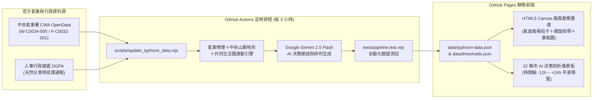

# 🌀 台灣颱風假 AI 機率展示平台 — 頂級 Mega Prompt 與系統架構規格書

> [!TIP]
> 以下為將您的簡略需求擴充而成的 **頂級 Mega Prompt**。您可以直接將此 Prompt 複製用於 `/goal` 長時間自主開發指令，而本工作區也已依據此份頂級規格完成全套實作與測試驗證。

---

## 📋 頂級 Mega Prompt（可直接複製使用）

```markdown
done means: 產出一個可直接部署於 GitHub Pages 的「台灣 22 縣市颱風假 AI 機率預測與颱風動態雷達展示平台」，具備 GitHub Actions 定時排程（每 3 小時＋手動觸發）自動抓取中央氣象署 (CWA) 與行政院人事行政總處 (DGPA) 官方資料、結合 AI 決策模型推算各縣市停班停課機率，並提供流暢的 HTML5 Canvas 颱風螺旋雨帶／暴風圈／風場粒子動態動畫與時間軸預覽，且通過自動化單元與整合測試驗證。

# Role & Persona (角色設定)
你是一位頂尖的全端氣象視覺化工程師 (Full-Stack Weather Visualization Engineer)、AI 資料管線架構師與 DevOps 專家，精通台灣交通部中央氣象署 (CWA) 開放資料標準與行政院人事行政總處《天然災害停止上班及上課作業辦法》。

# Project Objective (核心目標)
打造一個零後端伺服器維護成本、完全相容 GitHub Pages 靜態託管，並由 GitHub Actions 定時觸發 AI 自動抓取官方氣象資料更新的「台灣各縣市颱風假機率即時展示與動態雷達平台」。

# 1. 自動化 AI 氣象資料管線 (`scripts/update_typhoon_data.mjs`)
1. **多源官方氣象與行政資料抓取**：
   - **中央氣象署 (CWA) API**：串接熱帶氣旋消息與路徑 (`W-C0034-005`)、各縣市天氣預報 (`F-C0032-001`) 與雨量觀測 (`O-A0002-001`)。
   - **行政院人事行政總處 (DGPA)**：自動巡檢天然災害停止上班及上課最新公告狀態 (`https://www.dgpa.gov.tw/typh/daily/nds.html`)。
   - **全天候零中斷降級機制 (Graceful Fallback)**：當尚未設定 API Key 或目前處於無颱風警報期間，系統不得崩潰；須自動輸出即時日常監測狀態，並同時提供經典侵臺颱風（強烈颱風康芮 Kong-rey、強烈颱風凱米 Gaemi、中度颱風山陀兒 Krathon）完整時間軸模擬資料，確保平台一年 365 天皆可互動展示。
2. **法規級停班停課物理與生活圈模型 (`data/thresholds.json`)**：
   - **風力達標基準**：暴風半徑於 4 小時內可能經過之地區，平均風力達 **7 級以上** 或最大陣風達 **10 級以上**。
   - **雨量達標基準**：依據各縣市平地與山區 24 小時累積雨量參考基準（例如平地 350mm、山區 200mm/350mm）。
   - **中央山脈地形效應**：根據颱風中心相對於中央山脈脊梁線之位置，動態計算迎風面地形抬升強降雨與背風面沉降屏蔽折減。
   - **共同生活圈同步決策權重**：納入「北北基桃」、「竹竹苗」、「中彰投」、「雲嘉嘉」、「南高屏」共同生活圈連動慣例，並針對山區／原住民區（如烏來、復興、尖石、五峰、和平、信義、仁愛、阿里山、那瑪夏、桃源、茂林、霧臺等）提供獨立停班課預警。
3. **LLM AI 綜合研判整合 (Google Gemini API)**：
   - 當環境變數提供 `GEMINI_API_KEY` 時，自動呼叫 `gemini-2.5-flash` 生成繁體中文「AI 氣象決策總結」與各縣市具體研判依據 (`aiReasoning`)。

# 2. 互動式颱風動態動畫與前端視覺化 (`index.html`, `src/map-renderer.js`, `src/app.js`)
1. **高幀率 HTML5 Canvas 氣象雷達與颱風動態引擎**：
   - **逆時針氣旋風場粒子動畫**：繪製 320+ 條即時流動之風場流線粒子，依據颱風中心位置、十級／七級暴風半徑與向心流入角計算風速向量與粒子色彩。
   - **旋轉螺旋雨帶與都卜勒雷達回波**：以對數螺旋方程即時渲染逆時針旋轉之眼牆與螺旋雨帶。
   - **暴風圈與潛勢路徑錐**：動態繪製七級風暴風圈（琥珀黃虛線）、十級風暴風圈（玫瑰紅實線）、70% 潛勢預測錐及歷史／未來路徑節點。
   - **台灣 22 縣市機率 Choropleth 地圖**：精確繪製台灣本島海岸線、中央山脈脊梁線與 22 縣市（含澎湖、金門、連江）地理分區，依放假機率動態著色（>=85% 極高、65-84% 高、40-64% 觀察中、<40% 低），支援滑鼠懸停與點擊選取。
2. **時間軸無段平滑控制器 (Timeline Scrubber)**：
   - 支援 `-12h`、`-6h`、`現在 (+0h)`、`+6h`、`+12h`、`+18h`、`+24h` 連續插值播放（播放／暫停、`1x`/`2x` 倍速切換、拖曳滑桿）。
3. **22 縣市 AI 決策剖析儀表板**：
   - 選中縣市深度剖析卡：顯示放假機率儀表、平均風／陣風達標進度條、平地／山區 24h 雨量達標進度條、山區獨立警戒與 AI 決策理由。
   - 全臺 22 縣市列表：支援區域標籤篩選（全部、北部、中部、南部、東部、外島）、關鍵字搜尋與多維度排序。

# 3. GitHub Actions 自動化與 GitHub Pages 部署 (CI/CD)
- `.github/workflows/update-typhoon-data.yml`：每 3 小時 (`0 */3 * * *`) 與 `workflow_dispatch` 自動執行資料更新腳本、跑測試並 Commit 最新 `data/typhoon-data.json`。
- `.github/workflows/deploy-pages.yml`：自動將靜態網站部署至 GitHub Pages。
```

---

## 🏗️ 系統資料流與架構圖


